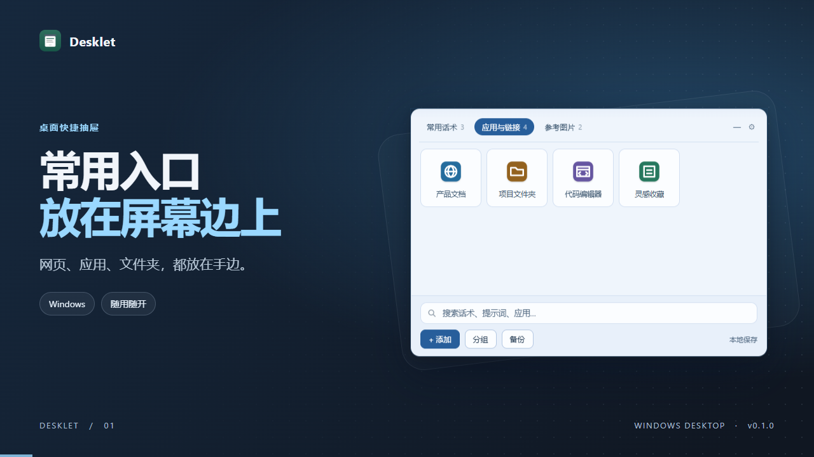

# Desklet · 桌面快捷抽屉

把常用网页、应用、文件夹、话术和图片放在屏幕边上。需要时用快捷键呼出，忙完就收回去。



## 开始使用

1. 从仓库的 **Releases** 下载 `Desklet-0.1.0-win-x64.exe`，保存后双击运行。
2. 按 **Ctrl + Alt + 空格** 展开或收起。可以在 **设置 → 桌面操作** 修改组合键。
3. 把浏览器链接或资源管理器里的应用、快捷方式、文件夹拖入抽屉。也可以在抽屉展开后粘贴网址。点卡片即可打开。

桌面版面向 Windows x64，运行需要 Microsoft Edge WebView2。关闭窗口后程序会留在托盘，想结束运行时可从托盘选择 **退出 Desklet**。

## 能做什么

- 窗口可贴上、下、左、右四边，也能独立悬浮。拖离屏幕边缘切回悬浮，悬浮窗可以拖动边缘调整尺寸。
- 悬浮窗可以闲置收成可拖动的小球。五套配色可即时切换，也可跟随系统。
- 用分组整理快捷入口、文字和图片。应用和文件夹尽量使用系统图标，网页尝试读取站点图标。
- 数据保存在本机。通过面板底部的 **备份** 导出 JSON，可以自行选择文件名和位置。导入会替换当前条目，建议先导出一份。网页图标加载时可能访问对应站点。

## 从源码运行

需要 Node.js、Rust MSVC 工具链、Visual Studio C++ Build Tools、Windows SDK 和 WebView2。进入仓库根目录，在 PowerShell 中执行：

```powershell
npm ci
npm run dev:plain
```

运行 `npm run build` 可构建发布版和 NSIS 安装包。只需要生成可直接运行的程序时，也可以执行：

```powershell
cargo build --locked --release --manifest-path src-tauri/Cargo.toml --features tauri/custom-protocol
```

`ui/` 是界面源码，`src-tauri/` 负责 Windows 窗口、托盘、快捷键、拖放和启动。提交问题时请附上 Windows 版本、Desklet 版本和复现步骤。路径、网址和备份内容中可能包含个人信息，贴到公开问题前请先遮掉。

## 许可

Desklet 使用 [MIT 许可证](LICENSE)。依赖项保留各自的许可。
